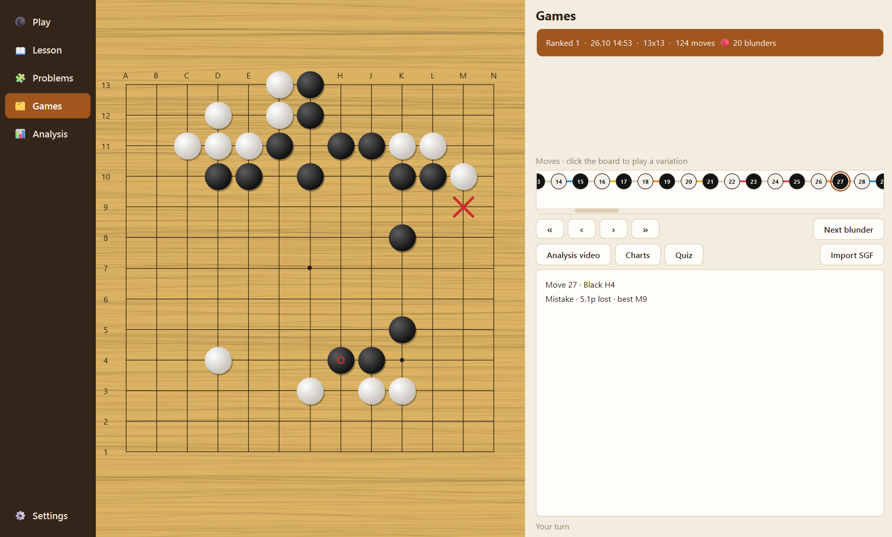

# GoMentor

A Go (Baduk) coach. It scores every move and tells you **why** it wasn't the
best one — in a sentence, not a number.

*Türkçe: [README.tr.md](README.tr.md)*



Move scoring is a solved problem (AI Sensei, KaTrain). The two things that are
different here:

- **Why.** "The real empty space was the left side, and the point the engine
  wanted, C4, was right there; you played in the centre." That sentence does
  not come out of the engine — it is computed from the board.
- **The move one rank above you.** Showing KataGo's best move to a 15k usually
  doesn't help. With HumanSL three distributions sit side by side: what you
  played, what your rank plays, and what one rank above you plays.

On top of that: a cross-game **mistake pattern** report (how many games you
have been repeating the same error), a **quiz** that replays your own
mistakes at you, and an end-of-game **narrated analysis video** — two
speakers, an animated board (the key point still waiting, the engine's
follow-up line), a score chart, and one-line definitions of each term the
first time a beginner meets it. The app writes the script itself: no LLM, API
key or subscription needed, and because the narration is built only from
measured data it structurally cannot make something up. If `agy` is installed
you can optionally have an LLM polish the wording.

Moves fall into six categories (Perfect · Great · Good · Inaccuracy · Mistake
· Blunder). If a past game contains a **blunder** the game gets a badge and
opens just before that move: it stays "uncorrected" until you find a move that
isn't a blunder. You can play a **variation** from any point of a past game
(you play both sides); branches never touch your statistics or your rank.
During a game the move strip lets you look back at earlier positions.
Shortcuts: `←` `→` `Home` `End`, and `Esc` to return to the live position.

In a casual game the app stays quiet; only a blunder stops the game and gets
explained. On the **Analysis** screen the blunders you corrected come back on
spaced repetition (1 → 3 → 7 → 14 → 30 days), along with your habits and your
progress charts. **Settings** has five looks (Classic, Wood, Dark, Paper, High
contrast), stone sound, a rules tour for beginners, and the interface language.

**Turkish and English.** The whole interface, the coaching text, the reports
and the analysis video exist in both languages; the language picker in
Settings applies immediately, and the video is narrated by Turkish or en-US
voices to match the language the script was written in. The voices are
Microsoft Edge's online text-to-speech (through `edge-tts`), so the video needs
an internet connection.

Stone sounds come from [KaTrain](https://github.com/sanderland/katrain)
(MIT, recorded by Jordan Seaward); see `sounds/LICENSE.txt`.

---

## Install

### Windows

Easiest: download and run `GoMentor-setup-*.exe` from the
[Releases](../../releases) page. It asks where to install and creates the
shortcuts. KataGo is bundled. The analysis video also needs FFmpeg, which is
not bundled: `winget install Gyan.FFmpeg`, then restart GoMentor. Playing,
analysis and problems work without it.

If you prefer the folder build (`GoMentor-windows.zip`), **extract the zip
first.** Windows shows a zip as if it were a folder but does not unpack it;
running the exe from inside it extracts only `GoMentor.exe` to a temp folder
and you get *"Failed to load Python DLL"* — the `_internal/` next to it isn't
there. Right click → Extract All, then run it from the extracted folder.

> **Put the app in a folder with ASCII-only characters.** KataGo is a C++
> program and opens paths through the Windows ANSI code page; in a folder with
> emoji or unusual characters it dies saying *"does not exist"* even though the
> file is right there. The app checks this at startup and warns you.

First launch depends on your GPU: the tuning cache ships with the package, so
on the same GPU it takes ~15 seconds. On a different GPU KataGo tunes itself
once, which can take a few minutes — the app says so in the status line.

### macOS (Apple Silicon)

> The `.dmg` is built by CI, but it has not been tested on a real Mac yet.

On a Mac, KataGo and ffmpeg will come from **Homebrew**: KataGo has no
official macOS build, and the Homebrew binary links against its own libraries
so it cannot be embedded in the app. The weights are platform independent and
will ship inside the `.dmg`.

```bash
brew install katago ffmpeg
```

The app looks for the executables next to itself first and falls back to
`PATH` — so there is nothing else to configure.

The build is unsigned, so macOS will block the first launch: **right click →
Open**.

---

## Letting Claude do the install

If the install gets stuck, hand the text below to Claude as it is:

```
I am trying to install a Go analysis app called GoMentor on my Mac
(Apple Silicon). The app is downloaded and sits in /Applications.

It needs two external tools to run:
  - katago  (the Go engine, the build with the Metal backend)
  - ffmpeg  (to produce the analysis video)

Both come from Homebrew. What I want you to do:

1. Check whether Homebrew is installed and install it if not.
2. Run `brew install katago ffmpeg`.
3. Verify with `which katago` and `which ffmpeg` that both are on PATH. The
   app looks for them on PATH, nothing else needs configuring.
4. Run `katago version` and confirm you see the Metal backend. If you don't,
   tell me which backend was compiled in.
5. Open the app. If it doesn't start, look at this file and tell me what it
   says:
   ~/Library/Application Support/GoMentor/games/log/app.log

If a step fails, stop and show me the error; do not carry on guessing. Ask me
before making any permanent change to my system (editing PATH, deleting
files).
```

The last two sentences are deliberate: the install is four commands and Claude
does not need to be creative — the real job is diagnosing it when something
goes wrong.

---

## Where your data lives

The app writes **wherever it can write**, with nothing to configure:

| situation | data folder |
|---|---|
| portable folder (writable) | `games/` next to the app |
| installed (Program Files / Applications) | `%LOCALAPPDATA%\GoMentor` · `~/Library/Application Support/GoMentor` |

KataGo's own logs and its GPU tuning cache are handled separately: their path
additionally has to be **ANSI-safe** (that's the reason for the warning above).

**Coming from go-hoca?** GoMentor was called go-hoca before. On first start
it finds the old `maclar/` folder, copies your games, ranks and review cards
into the new `games/` folder and converts them; the old folder is left
untouched.

---

## Development

```bash
python coach.py --selftest      # no engine needed, takes seconds
python coach.py --uitest        # builds and walks the UI without showing a window
python ui.py                    # run the app
python build.py                 # build the Windows package
python build.py --license-audit # third-party notices: complete and current?
```

Running from source, KataGo is looked up in this order: `GOMENTOR_KATAGO_DIR`,
`katago/` in the project folder, `~/katago`. That folder needs
`katago(.exe)`, `kata1.bin.gz`, `humanv0.bin.gz` and `analysis_example.cfg`;
the files are in the `engine-v1` release (see below). If something is missing
the app tells you which one.

`--uitest` exists on purpose: `--selftest` does not import the UI, and this
project was once broken for exactly that reason — the tests were green while
the app wouldn't open at all because of a syntax error.

**Build from a clean venv.** Anaconda's packages (Pillow, aiohttp) keep their
DLLs under `Library/bin`, PyInstaller does not look there, and the package
won't even start, saying *"DLL load failed while importing _imaging"*.

```bash
python -m venv .venv-build
.venv-build/Scripts/python -m pip install pillow edge-tts==7.3.1 pyinstaller PySide6==6.9.2
```

### Layers

The UI knows nothing about the engine; the engine knows nothing about files.
Moving the UI from tkinter to Qt did not change a single line of
`goban / engine / scoring / store / video`.

| file | job |
|---|---|
| `goban.py` | rules, coordinates, SGF — pure |
| `engine.py` | KataGo client |
| `scoring.py` | scoring, the rank scale, detections, brief, pattern report |
| `store.py` | game store |
| `i18n.py` | interface language (`t("Türkçe", "English")`) — pure, knows no files |
| `narration.py` | video script: event detection, templates, Turkish number/suffix generation, glossary — pure |
| `video.py` | analysis video: scenes, animation, narration, muxing (PIL + edge-tts + ffmpeg) |
| `charts.py` | statistics charts (QPainter) |
| `tsumego.py` | life-and-death problems: SGF sets, solver, Leitner cards |
| `sgf_import.py` | importing outside SGF games |
| `bundle.py` | frozen/source and platform differences — in one place |
| `legacy.py` | one-time import of data saved under the old name |
| `ui.py` | the PySide6 UI |
| `theme.py` | themes (tokens → QSS) — no Qt |
| `coach.py` | command line and tests |
| `build.py` | Windows / macOS package |

Two notes on the bilingual layer, because both cost a bug first:

- `t()` reads the selected language **at call time**. A module-level constant
  would freeze at import time in whatever language was loaded, so every string
  is produced where it is used.
- Changing the language rebuilds the widgets (the labels already built keep
  their old language otherwise). The rebuild restores the *mode*, not the
  screen: the mode of the Play screen is read off the ranked/casual button,
  and a freshly built button dropped back to casual — which made the rebuild
  look like a different game and killed a live ranked one.

### Measured constants

Not one constant in this project was invented. Each comes from an experiment
(bot-vs-bot calibration runs; the calibration scripts are not part of this
repository):

| constant | value | from |
|---|---|---|
| `D` (Elo scale) | 1090 (9x9) · 730 (13x13) · 460 (19x19) | 360 + 180 + 180 bot-vs-bot games |
| `LEVEL_OFFSET` | 4.3 | the tool was systematically inflated |
| `OPEN_THRESHOLD / OPEN_RATIO` | 6.0 / 2.0 | `coach.py --big-points`, 524 moves |
| bot floor | 30k (9x9) · 26k (13x13) · 23k (19x19) | measured by weakening the 20k profile |

Level estimation is only produced on 9x9: on the larger boards it was measured
and does not separate ranks, so it is switched off at the source rather than
printed as a guess. `OPEN_THRESHOLD / OPEN_RATIO` were measured on 9x9 only.

---

## Release assets

The weights and the engine binary are **not** in the repo (369 MB). They live
in the `engine-v1` release, and CI pulls them from there:

| file | size |
|---|---|
| `katago-windows.zip` | 16 MB |
| `kata1.bin.gz` | 259 MB |
| `humanv0.bin.gz` | 94 MB |

Git LFS was not used: every clone would pull 354 MB.

---

## License

**GoMentor's own code is MIT** (`LICENSE`).

The packaged application also ships third-party programs under their own
licenses. Two of them place obligations on anyone who redistributes the
package:

| component | license | how it is used |
|---|---|---|
| FFmpeg 7.1.1 libraries inside PySide6 | LGPL v2.1+ | replaceable DLLs (in-app video player) |
| Qt / PySide6 / shiboken6 6.9.2 | **LGPL v3** | replaceable DLLs in `_internal/` |
| edge-tts 7.3.1 | **LGPL v3** | imported as a library |
| KataGo v1.18.1 + its networks | MIT | separate process |
| stone sounds (KaTrain) | MIT | data |
| Pillow, aiohttp, attrs, certifi, idna, … | permissive | libraries |

The `ffmpeg` program itself is **not bundled** (it was up to v0.2.3).
gyan.dev's static GPLv3 build links about fifty libraries and its build
scripts are not published, so the full Corresponding Source GPLv3 asks for
could not be offered. You install FFmpeg yourself; GoMentor runs it as a
separate process, finds it on `PATH`, and only the analysis video needs it.

`b18c384nbt-humanv0` is MIT licensed, but **the provenance of its training
data is not documented upstream.** The product thesis "the move one rank
above you" depends on that network, so it is said out loud rather than buried.

Full texts are in `LICENSES/`, the component-by-component account with source
locations is in `THIRD-PARTY-NOTICES.md`, and the app shows it under
**Settings → Licenses**. `python build.py --license-audit` verifies that every
bundled component has a notice; the build refuses to run if one is missing.

This is a record of licenses and obligations, not legal advice.
