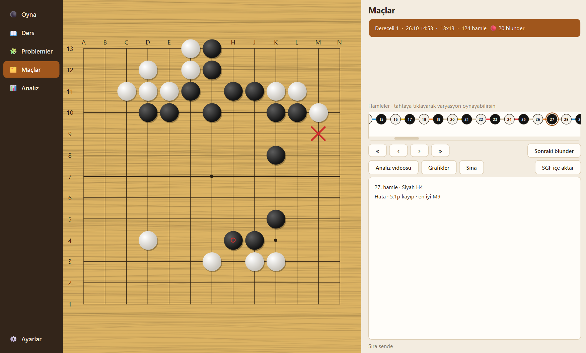

# GoMentor

Go (Baduk) öğretmeni. Her hamleye puan verir ve **neden** en iyi olmadığını
anlatır — sayı değil, cümle.

*English: [README.md](README.md)*



Piyasada hamle puanlama çözülmüş bir problem (AI Sensei, KaTrain). Buradaki
iki fark:

- **Neden.** "Tahtanın asıl boş yeri sol bölgesiydi ve motorun istediği C4
  orada; sen merkezde oynadın." Bu cümle motordan çıkmıyor, tahtadan
  hesaplanıyor.
- **Bir üst seviyenin hamlesi.** Bir 15k'ya KataGo'nun en iyi hamlesini
  göstermek çoğu zaman işe yaramaz. HumanSL ile üç dağılım yan yana konuyor:
  senin oynadığın, senin seviyenin oynadığı, bir üst seviyenin oynadığı.

Ayrıca: maçlar arası **hata örgüsü** (aynı hatayı kaç maçtır tekrar
ediyorsun), kendi hatalarını geri oynatan **sınav**, ve maç sonu **sesli +
görüntülü analiz videosu**: iki anlatıcı, animasyonlu tahta (bekleyen kilit
nokta, motorun devam çizgisi), skor grafiği, yeni başlayan için terim
açıklamaları. Metni uygulama kendisi yazar — LLM, API anahtarı ya da abonelik
gerekmez; anlatım yalnız ölçülmüş verilerden kurulduğu için uydurma yapamaz.
`agy` kuruluysa metni isteğe bağlı olarak LLM'e cilalatabilirsin.

Hamleler altı kategoriye ayrılır (Mükemmel · Harika · İyi · Kusurlu · Hata ·
Blunder). Eski maçta **blunder** varsa maç rozetle işaretlenir ve o hamlenin
öncesinde açılır: blunder olmayan bir hamle bulana kadar "düzeltilmedi" kalır.
Eski maçın herhangi bir anından **varyasyon** oynanabilir (iki tarafı da sen
oynarsın); dallar istatistiğe ve rank'a karışmaz. Oyun sırasında hamle
şeridinden geçmiş pozisyonlara bakılır. Kısayollar: `←` `→` `Home` `End`,
`Esc` canlıya dön.

Serbest maçta uygulama sessizdir; yalnız blunder'da maç durur ve nedenini
anlatır. **Analiz** ekranında düzelttiğin blunder'lar aralıklı tekrarla
(1 → 3 → 7 → 14 → 30 gün) geri gelir; alışkanlıkların ve gelişim grafiklerin
de orada. **Ayarlar**'da beş görünüm (Klasik, Ahşap, Karanlık, Kağıt, Yüksek
kontrast), taş sesi, yeni başlayanlar için kural turu ve arayüz dili var.

**Türkçe ve İngilizce.** Arayüzün tamamı, koçluk metinleri, raporlar ve analiz
videosu iki dilde; Ayarlar'daki dil seçici anında uygulanır ve video, senaryo
hangi dilde yazıldıysa Türkçe ya da en-US seslerle anlatılır. Sesler Microsoft Edge'in
çevrimiçi metin okuma servisinden (`edge-tts` ile) geliyor, bu yüzden video için
internet gerekir.

Taş sesleri [KaTrain](https://github.com/sanderland/katrain)'den (MIT, kayıt: Jordan
Seaward); ayrıntı `sounds/LICENSE.txt`.

---

## Kurulum

### Windows

En kolayı: [Releases](../../releases) sayfasından `GoMentor-setup-*.exe`
installer'ini indir ve çalıştır. Kurulum yerini sorar, kısayolları koyar.
KataGo paketin içinde. Analiz videosu için FFmpeg de gerekiyor, o pakette
değil: `winget install Gyan.FFmpeg`, sonra GoMentor'yı yeniden başlat. Oyun,
analiz ve problemler FFmpeg'siz çalışır.

Klasör hâlini (`GoMentor-windows.zip`) tercih edersen **zip'i önce ayıkla.**
Windows zip'i klasör gibi gösterir ama açmaz; içeriden çalıştırınca yalnız
`GoMentor.exe` geçici klasöre çıkar ve *"Failed to load Python DLL"* alırsın —
yanındaki `_internal/` orada değildir. Sağ tık → Tümünü ayıkla, sonra çıkan
klasörden çalıştır.

> **Uygulamayı ASCII karakterli bir klasöre koy.** KataGo bir C++ programı ve
> yolları Windows'un ANSI kod sayfasıyla açıyor; emoji ya da alışılmadık
> karakter içeren bir klasörde *"does not exist"* deyip ölüyor — dosya yerinde
> olmasına rağmen. Uygulama açılışta bunu kontrol edip uyarıyor.

İlk açılış GPU'ya göre değişir: ayar önbelleği paketle geliyor, aynı GPU'da
~15 saniye. Farklı bir GPU'da KataGo bir kereye mahsus ayar yapar, birkaç
dakika sürebilir — uygulama bunu durum satırında söyler.

### macOS (Apple Silicon)

> `.dmg` CI'da üretiliyor ama henüz gerçek bir Mac'te denenmedi.

Mac'te KataGo ve ffmpeg **Homebrew'dan** gelecek: KataGo'nun resmî macOS
sürümü yok ve Homebrew'un ikilisi kendi kitaplıklarına bağlı olduğu için
uygulamanın içine gömülemiyor. Ağırlıklar platformdan bağımsız, `.dmg`'nin
içinde gelecek.

```bash
brew install katago ffmpeg
```

Uygulama çalıştırılabilirleri önce kendi yanında, bulamazsa `PATH`'te arar —
yani başka ayar yapman gerekmiyor.

İmzalama yapılmadığı için macOS ilk açılışta engelleyecek: **sağ tık → Aç**.

---

## Kurulumu Claude'a yaptırmak

Kurulum tıkanırsa aşağıdaki metni olduğu gibi Claude'a ver:

```
Mac'imde (Apple Silicon) GoMentor adlı bir Go analiz uygulamasını kurmaya
çalışıyorum. Uygulama indirildi ve /Applications altında duruyor.

Uygulamanın çalışması için iki dış araca ihtiyacı var:
  - katago  (Go motoru, Metal backend'li sürüm)
  - ffmpeg  (analiz videosu üretmek için)

İkisi de Homebrew'dan geliyor. Yapmanı istediklerim:

1. Homebrew kurulu mu bak, değilse kur.
2. `brew install katago ffmpeg` çalıştır.
3. `which katago` ve `which ffmpeg` ile ikisinin de PATH'te göründüğünü
   doğrula. Uygulama onları PATH'ten arıyor, başka ayar gerekmiyor.
4. `katago version` çalıştır ve Metal backend'i gördüğünü teyit et.
   Görmezsen bana hangi backend'in derlendiğini söyle.
5. Uygulamayı aç. Açılmazsa şu dosyaya bak ve bana ne yazdığını söyle:
   ~/Library/Application Support/GoMentor/games/log/app.log

Bir adım hata verirse durup bana hatayı göster; tahminle devam etme.
Sistemime kalıcı bir değişiklik yapmadan önce (PATH düzenlemek, dosya
silmek gibi) bana sor.
```

Son iki cümle bilinçli: kurulum dört komut, Claude'un yaratıcı olmasına gerek
yok — asıl işi bir şey ters gittiğinde teşhis koymak.

---

## Verilerin nerede durduğu

Uygulama **yazabildiği yere** yazar, ayar gerekmiyor:

| durum | veri klasörü |
|---|---|
| taşınabilir klasör (yazılabilir) | uygulamanın yanında `games/` |
| kurulu (Program Files / Applications) | `%LOCALAPPDATA%\GoMentor` · `~/Library/Application Support/GoMentor` |

KataGo'nun kendi logları ve GPU ayar önbelleği ayrı çözülüyor: onların yolu
ek olarak **ANSI-güvenli** olmak zorunda (yukarıdaki uyarının sebebi).

**go-hoca'dan mı geliyorsun?** GoMentor'un eski adı go-hoca'ydı. İlk açılışta
eski `maclar/` klasörünü bulur; maçlarını, rankını ve tekrar kartlarını yeni
`games/` klasörüne kopyalayıp dönüştürür. Eski klasöre dokunmaz.

---

## Geliştirme

```bash
python coach.py --selftest      # motorsuz, saniyeler
python coach.py --uitest        # arayüzü pencere açmadan kurar ve gezer
python ui.py                    # uygulamayı çalıştır
python build.py                 # Windows paketi üret
python build.py --license-audit # üçüncü taraf bildirimleri tam ve güncel mi
```

Kaynaktan çalışırken KataGo sırayla şuralarda aranır: `GOMENTOR_KATAGO_DIR`,
proje klasöründeki `katago/`, `~/katago`. Klasörde `katago(.exe)`,
`kata1.bin.gz`, `humanv0.bin.gz` ve `analysis_example.cfg` olmalı; dosyalar
`engine-v1` release'inde (aşağıda). Eksik varsa uygulama hangisinin eksik
olduğunu söyler.

`--uitest` bilerek var: `--selftest` arayüzü import etmiyor ve proje bir kez
tam bu yüzden kırık kaldı — testler yeşildi, uygulama sözdizimi hatasından
hiç açılmıyordu.

**Derleme temiz bir venv'den yapılır.** Anaconda paketleri (Pillow, aiohttp)
DLL'lerini `Library/bin` altında tutuyor, PyInstaller oraya bakmıyor ve paket
*"DLL load failed while importing _imaging"* diyerek açılmıyor bile.

```bash
python -m venv .venv-build
.venv-build/Scripts/python -m pip install pillow edge-tts==7.3.1 pyinstaller PySide6==6.9.2
```

### Katmanlar

Arayüz motoru bilmez, motor dosyayı bilmez. Arayüzü tkinter'dan Qt'ye taşırken
`goban / engine / scoring / store / video` dosyalarının tek satırı değişmedi.

| dosya | iş |
|---|---|
| `goban.py` | kurallar, koordinatlar, SGF — saf |
| `engine.py` | KataGo istemcisi |
| `scoring.py` | puanlama, seviye ölçeği, tespitler, brief, örgü |
| `store.py` | maç deposu |
| `i18n.py` | arayüz dili (`t("Türkçe", "English")`) — saf, dosya bilmez |
| `narration.py` | video metni: olay tespiti, şablonlar, Türkçe sayı/ek, terim sözlüğü — saf |
| `video.py` | analiz videosu: sahneler, animasyon, seslendirme, montaj (PIL + edge-tts + ffmpeg) |
| `charts.py` | istatistik grafikleri (QPainter) |
| `tsumego.py` | hayat-ölüm problemleri: SGF setleri, çözücü, Leitner kartları |
| `sgf_import.py` | dış SGF maçlarını içe aktarma |
| `bundle.py` | donmuş/kaynak ve platform farkları — tek yerde |
| `legacy.py` | eski adla kaydedilmiş verinin bir kerelik aktarımı |
| `ui.py` | PySide6 arayüz |
| `theme.py` | temalar (token → QSS) — Qt'siz |
| `coach.py` | komut satırı ve testler |
| `build.py` | Windows / macOS paketi |

### Ölçülen sabitler

Bu projede hiçbir sabit uydurulmadı. Her biri bir deneyden geliyor (bot-bot
kalibrasyon koşuları; kalibrasyon betikleri bu repoda değil):

| sabit | değer | nereden |
|---|---|---|
| `D` (Elo ölçeği) | 1090 (9x9) · 730 (13x13) · 460 (19x19) | 360 + 180 + 180 bot-bot maçı |
| `LEVEL_OFFSET` | 4.3 | araç sistematik şişikti |
| `OPEN_THRESHOLD / OPEN_RATIO` | 6.0 / 2.0 | `coach.py --big-points`, 524 hamle |
| bot tabanı | 30k (9x9) · 26k (13x13) · 23k (19x19) | 20k profilini zayıflatarak ölçüldü |

Seviye tahmini yalnız 9x9'da üretiliyor: büyük tahtalarda ölçüldü ve rankları
ayırmıyor, o yüzden tahmin basmak yerine kaynakta kapatıldı.
`OPEN_THRESHOLD / OPEN_RATIO` yalnız 9x9'da ölçüldü.

---

## Release varlıkları

Ağırlıklar ve motor ikilisi repoda **değil** (369 MB). `engine-v1` release'inde
duruyorlar, CI oradan çekiyor:

| dosya | boyut |
|---|---|
| `katago-windows.zip` | 16 MB |
| `kata1.bin.gz` | 259 MB |
| `humanv0.bin.gz` | 94 MB |

Git LFS kullanılmadı: her klon 354 MB indirirdi.

---

## Lisans

**GoMentor'nın kendi kodu MIT** (`LICENSE`).

Paketlenen uygulama ayrıca kendi lisanslarıyla gelen üçüncü taraf programlar
taşıyor. İkisi, paketi yeniden dağıtan herkese yükümlülük yüklüyor:

| bileşen | lisans | nasıl kullanılıyor |
|---|---|---|
| PySide6 içindeki FFmpeg 7.1.1 kütüphaneleri | LGPL v2.1+ | değiştirilebilir DLL (uygulama içi video oynatıcı) |
| Qt / PySide6 / shiboken6 6.9.2 | **LGPL v3** | `_internal/` içinde değiştirilebilir DLL |
| edge-tts 7.3.1 | **LGPL v3** | kütüphane olarak import ediliyor |
| KataGo v1.18.1 + ağları | MIT | ayrı süreç |
| taş sesleri (KaTrain) | MIT | veri |
| Pillow, aiohttp, attrs, certifi, idna, … | izin verici | kütüphane |

`ffmpeg` programının kendisi **pakette değil** (v0.2.3'e kadar vardı).
gyan.dev'in statik GPLv3 derlemesi elli kadar kütüphaneyi gömüyor ve derleme
betiklerini yayımlamıyor; GPLv3'ün istediği tam kaynak bu yüzden
verilemiyordu. FFmpeg'i kendin kuruyorsun; GoMentor onu ayrı bir süreç olarak
çalıştırıyor, `PATH`'ten buluyor ve yalnız analiz videosu ona ihtiyaç duyuyor.

`b18c384nbt-humanv0` MIT lisanslı ama **eğitim verisinin kaynağı upstream
tarafından belgelenmemiş.** "Bir üst seviyenin hamlesi" ürün tezi bu ağa
bağlı, o yüzden gömülmek yerine açıkça yazılıyor.

Tam metinler `LICENSES/` altında, bileşen bileşen döküm ve kaynak adresleri
`THIRD-PARTY-NOTICES.md`'de, uygulama da **Ayarlar → Lisanslar**'da gösteriyor.
`python build.py --license-audit` pakete giren her bileşenin bildirimi var mı
diye bakıyor; eksikse derleme başlamıyor.

Bu bir lisans ve yükümlülük dökümü, hukuki tavsiye değil.
